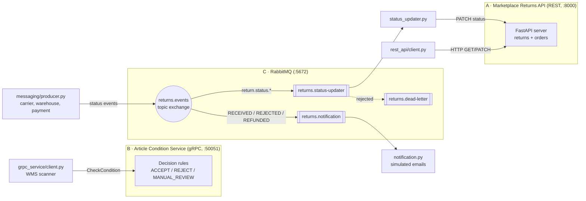

# ShopEasy Returns – Integration Components (Sprint 2)

Semester project for the module **Digitalisierung von Geschäftsprozessen** (HKA, WS 2026/27).
Sprint 2 builds three components for the digitalised returns process of the fictional
online retailer **ShopEasy GmbH**. Each component represents a system from the to-be process
(BPMN, Sprint 1) and uses a different integration style. In Sprint 4 they will be called from
a Camunda workflow.

| Component | Represents | Integration style | Folder |
|---|---|---|---|
| **A – Marketplace Returns API** | Return interfaces of Amazon / Zalando | REST (HTTP + JSON), synchronous | `rest_api/` |
| **B – Article Condition Service** | Automated condition check at goods receipt (WMS) | gRPC (Protocol Buffers), synchronous | `grpc_service/` |
| **C – Status updates** | Status events between the systems involved | Messaging (RabbitMQ), asynchronous | `messaging/` |

---

## Architecture



### Why three different integration styles?

| | A – REST | B – gRPC | C – Messaging |
|---|---|---|---|
| Communication | synchronous request/response | synchronous remote call | asynchronous, via broker |
| Both sides online at the same time? | yes | yes | no – messages wait in queues |
| Receivers | 1 | 1 | many (publish-subscribe) |
| Contract | OpenAPI (generated from code) | `.proto` file (contract-first) | event format + routing keys |
| Data format | JSON (readable) | Protocol Buffers (binary, compact) | JSON |
| **Reason in our process** | Marketplaces are **external partners**; REST/JSON is the common, interoperable standard. ShopEasy **polls** for new returns. | The condition check is an **internal, frequently called decision function**; the scanner needs an immediate answer; the strict contract prevents invalid values. | Many systems report status changes and many others need them (ERP, notifications, reporting). The broker **decouples** them in time and space, and new receivers can be added without changing the sender. |

Coupling follows the lecture's guideline *"as loose as possible, as tight as necessary"*:
A and B are tightly coupled in time (the caller waits) because an immediate answer is needed;
C is loosely coupled because status updates do not need an answer.

---

## Project structure

```
rest_api/
  data/mock_data.json     example returns and orders (in-memory "database")
  models.py               Pydantic models, return statuses, allowed status transitions
  main.py                 FastAPI server (4 endpoints, API key check)
  client.py               reusable REST client + demo scenario
grpc_service/
  protos/article_condition_service.proto   contract provided by the lecturer
  generated/              code generated from the .proto (do not edit)
  server.py               decision rules + 3 RPCs
  client.py               demo of all decision paths and error cases
messaging/
  common.py               RabbitMQ settings and topology (exchange, queues, bindings, DLQ)
  producer.py             publishes status events (demo or single event)
  status_updater.py       consumer: updates the status in component A
  notification.py         consumer: simulated customer notifications
bruno/marketplace-returns-api/   Bruno collection: 13 test requests with assertions
docs/AI_LOG.md            documentation of AI usage
requirements.txt          Python dependencies
```

---

## Setup

Requirements: **Python 3.13**, **Docker** (for RabbitMQ), optionally **Bruno** (API tests).

```bash
git clone <repository-url>
cd shopeasy-returns-integration
python3 -m venv .venv
source .venv/bin/activate            # Windows: .venv\Scripts\activate
python -m pip install -r requirements.txt
```

All commands below are run from the project root with the virtual environment active.
`python -m <tool>` is used on purpose, so the tools of the virtual environment are used.

| Port | Service |
|---|---|
| 8000 | Component A – REST API (Swagger UI: http://localhost:8000/docs) |
| 50051 | Component B – gRPC service |
| 5672 / 15672 | RabbitMQ / RabbitMQ dashboard (http://localhost:15672, `guest` / `guest`) |

---

## Component A – Marketplace Returns API (REST)

**Run**
```bash
python -m uvicorn rest_api.main:app --reload     # terminal 1
python -m rest_api.client                         # terminal 2: demo scenario
```

**Endpoints** (all require the header `X-API-Key`)

| Method | Path | Purpose | Responses |
|---|---|---|---|
| GET | `/returns?status=…&marketplace=…` | list returns, optional filters | 200, 422 |
| GET | `/returns/{returnId}` | one return | 200, 404 |
| GET | `/orders/{orderId}` | order data of a return | 200, 404 |
| PATCH | `/returns/{returnId}/status` | change the status, body `{"status": "APPROVED"}` | 200, 404, 409, 422 |

Every endpoint additionally answers **401** if the API key is missing or wrong.

**Return statuses and allowed transitions** (a state machine, `ALLOWED_TRANSITIONS` in `models.py`)

| From | Allowed next statuses |
|---|---|
| NEW | APPROVED, DENIED |
| APPROVED | LABEL_SENT |
| LABEL_SENT | IN_TRANSIT, RECEIVED, EXPIRED |
| IN_TRANSIT | RECEIVED |
| RECEIVED | INSPECTED |
| INSPECTED | ACCEPTED, REJECTED, MANUAL_REVIEW |
| MANUAL_REVIEW | ACCEPTED, REJECTED |
| ACCEPTED | REFUNDED |
| REFUNDED, REJECTED | CLOSED |
| DENIED, EXPIRED, CLOSED | – (end states) |

- A forbidden transition is answered with **409 Conflict** and lists the allowed next statuses.
- Setting the **same status again** is answered with 200 and changes nothing (**idempotent**).
  This matters for component C, where a message can be delivered more than once.
- `LABEL_SENT → RECEIVED` is allowed because a carrier's drop-off scan can be missing.

**Tests with Bruno:** open the collection `bruno/marketplace-returns-api`, select the environment
`local` and run the collection (restart the server first so the mock data is fresh).
All 13 requests contain an assertion for the expected status code.

---

## Component B – Article Condition Service (gRPC)

**Run**
```bash
python -m grpc_service.server      # terminal 1
python -m grpc_service.client      # terminal 2: demo of all scenarios
```

**RPCs** (from `article_condition_service.proto`)

| RPC | Purpose |
|---|---|
| `CheckCondition` | evaluate one article |
| `CheckConditionBatch` | evaluate several articles of one parcel (all-or-nothing validation) |
| `GetCheckResult` | retrieve a stored result again (audit) |

**Decision rules**

| Observed condition | Additional conditions | Decision | Confidence |
|---|---|---|---|
| AS_NEW | tags + original packaging | ACCEPT | 0.95 |
| AS_NEW | tags, no packaging | ACCEPT | 0.85 |
| AS_NEW | no tags | MANUAL_REVIEW | 0.60 (possible wardrobing) |
| MINOR_WEAR | – | MANUAL_REVIEW | 0.55 |
| MISSING_TAGS | – | MANUAL_REVIEW | 0.50 |
| DAMAGED | – | MANUAL_REVIEW | 0.40 (possible warranty claim) |
| VISIBLY_WORN | – | REJECT | 0.85 |
| MISSING_PARTS | – | REJECT | 0.80 |

General rules: no photos → confidence −0.10; ACCEPT/REJECT below 0.60 → MANUAL_REVIEW.
DAMAGED is never rejected automatically, because the damage may have existed at delivery
(warranty claim of the customer).

**Error handling**

| gRPC status | When |
|---|---|
| `INVALID_ARGUMENT` | `return_id`/`sku` missing, condition `UNSPECIFIED`, empty batch |
| `NOT_FOUND` | `GetCheckResult` for an article that was never checked |
| `DEADLINE_EXCEEDED` | client deadline (2 s) exceeded – demo: `inspector_note = "SIMULATE_SLOW"` |
| `UNAVAILABLE` | service not reachable – handled by the client with a clear message |

**Regenerate the code** after changing the `.proto`:
```bash
python -m grpc_tools.protoc -Igrpc_service/generated=grpc_service/protos \
  --python_out=. --pyi_out=. --grpc_python_out=. \
  grpc_service/protos/article_condition_service.proto
```

---

## Component C – Status updates via messaging (RabbitMQ)

**Run**
```bash
docker run -d --name rabbitmq -p 5672:5672 -p 15672:15672 rabbitmq:3-management
python -m uvicorn rest_api.main:app --reload    # terminal 1 – component A is updated by C
python -m messaging.status_updater              # terminal 2 – consumer
python -m messaging.notification                # terminal 3 – consumer
python -m messaging.producer                    # terminal 4 – demo scenario
python -m messaging.producer RET-2026-00457 RECEIVED   # or: one single event
```

**Topology** (declared by every program at start-up, `messaging/common.py`)

| Element | Type | Purpose |
|---|---|---|
| `returns.events` | topic exchange | receives all status events; routing key `return.status.<STATUS>` |
| `returns.status-updater` | queue, binding `return.status.*` | all status changes → PATCH on component A |
| `returns.notification` | queue, bindings for RECEIVED, REJECTED, REFUNDED | events the customer is informed about |
| `returns.dead-letter` | fanout exchange + queue | messages rejected by a consumer |

Exchanges and queues are **durable**, messages are **persistent** – they survive a broker restart.

**Event format**
```json
{
  "messageId": "7f3c9a2e-41d8-4c7e-9b1a-2f6d8e0c5a11",
  "returnId": "RET-2026-00457",
  "newStatus": "RECEIVED",
  "source": "WAREHOUSE",
  "occurredAt": "2026-10-29T10:15:00+00:00"
}
```

**Processing in the status updater** (manual acknowledgement, at-least-once delivery)

| Situation | Reaction | Result |
|---|---|---|
| status updated (200) | `ack` | message deleted |
| unreadable message, 404, 409, 422 (business error) | `reject` | message moved to the dead-letter queue – retrying would not help |
| component A not reachable, timeout, 5xx (technical error) | wait 5 s, `nack` with requeue | message stays in the queue and is retried |

The demo scenario sends the complete life cycle of one return, a duplicate event (handled
idempotently) and three faulty events that end up in the dead-letter queue. Messages sent while
no consumer is running wait in the queues (visible in the RabbitMQ dashboard).

---

## Security

**Implemented**
- API key authentication for component A: header `X-API-Key`, compared in constant time;
  the key is read from the environment variable `MARKETPLACE_API_KEY`
  (fallback `dev-secret-key` **for local development only**).
- Input validation: Pydantic models (422), protobuf enums + `INVALID_ARGUMENT`, allowed status transitions (409).
- Services listen locally; RabbitMQ's default user `guest` only works from localhost.

**Required for production (not implemented in the mocks)**
- Authorization per client (e.g. OAuth 2.0 scopes: read vs. change status) → 403 for forbidden actions
- Encrypted transport: HTTPS for REST, TLS (`add_secure_port`) for gRPC, TLS for AMQP
- Network isolation: internal services only reachable inside the company network; API gateway in front of external APIs
- Rate limiting against overload and abuse
- Audit log: who changed which status and when
- RabbitMQ: own users and passwords, permissions per queue/virtual host

---

## Design decisions and known limitations

- **In-memory data:** component A loads `mock_data.json` at start-up; changes are lost on restart (intended for a mock).
- **One shared status list:** in reality ShopEasy would keep its own return record and report status changes back to the marketplaces; for the mock the status lives in component A.
- **Independent services:** component B does not check whether a return exists in component A; combining the services in the right order is the task of the workflow (Sprint 4).
- **Message ordering:** if events are processed in the wrong order (e.g. RECEIVED before IN_TRANSIT), component A rejects the transition (409) and the event goes to the dead-letter queue.
- **Duplicates per consumer:** the status updater is idempotent through component A; the notification service does not yet remember processed `messageId`s and would send an email twice.
- **Independent consumers:** the notification service also reacts to events the status updater rejected (e.g. an unknown return) – the price of loose coupling.
- **Demo hook:** `SIMULATE_SLOW` in component B only exists to demonstrate client deadlines.
- **Generated gRPC code is committed** so the project runs without running the generator.

---

## AI usage

AI (Claude, Anthropic) was used as a tutor and for parts of the code.
What was generated, what I decided and what I learned is documented step by step in
[`docs/AI_LOG.md`](docs/AI_LOG.md).
